<p align="center">
  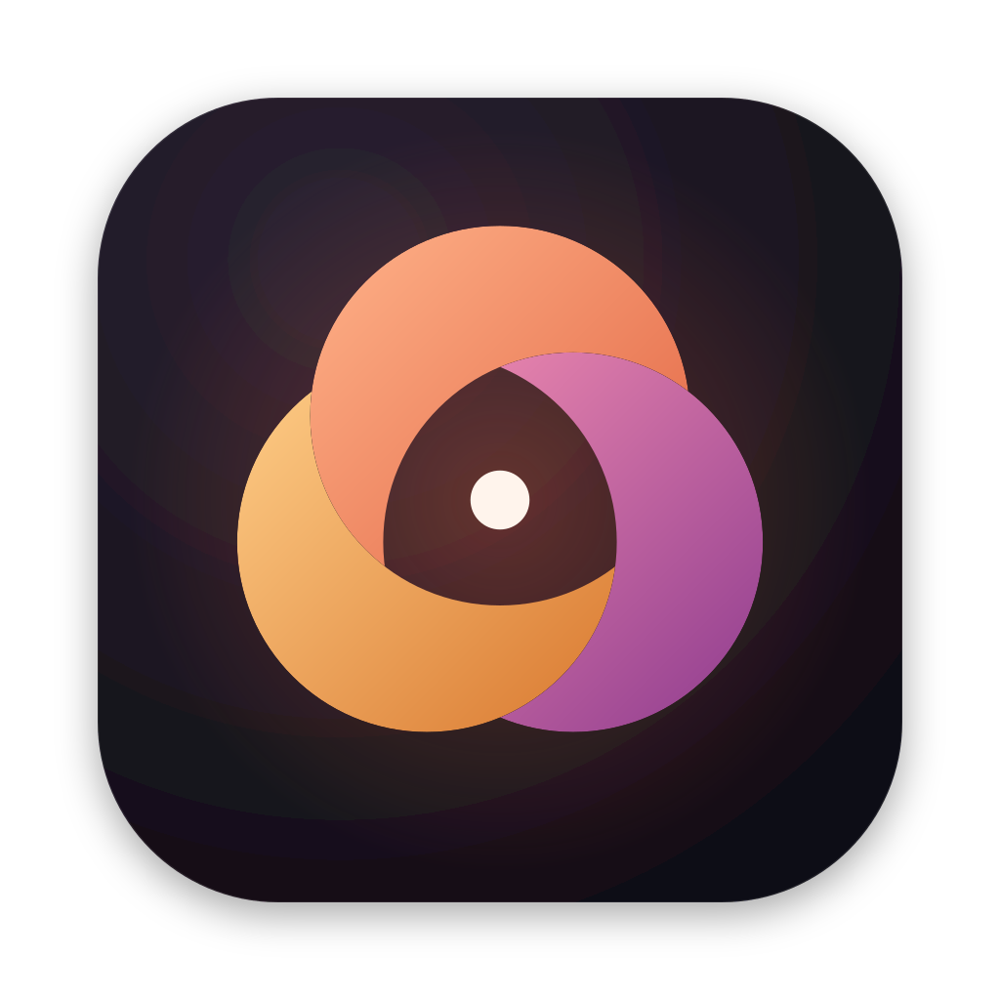
</p>

<h1 align="center">CSwapBar</h1>

<p align="center">
  <strong>All your Claude Code accounts, one click away in the macOS menu bar.</strong><br>
  A native SwiftUI companion for <a href="https://github.com/realiti4/claude-swap">CSwap</a>. See 5-hour and 7-day usage at a glance, switch accounts instantly, and hide everything with one toggle when you share your screen.
</p>

<p align="center">
  
  
  
  
  
  <a href="https://github.com/iamv1n/CSwapBar/releases/latest"></a>
</p>

<p align="center">
  <a href="https://iamv1n.github.io/CSwapBar/"><b>Website</b></a> ·
  <a href="https://github.com/iamv1n/CSwapBar/releases/latest"><b>Download</b></a> ·
  <a href="docs/INSTALL.md">Install guide</a> ·
  <a href="ROADMAP.md">Roadmap</a> ·
  <a href="CHANGELOG.md">Changelog</a> ·
  <a href="DEVELOPMENT.md">Development</a> ·
  <a href="CONTRIBUTING.md">Contributing</a>
</p>

<p align="center">
  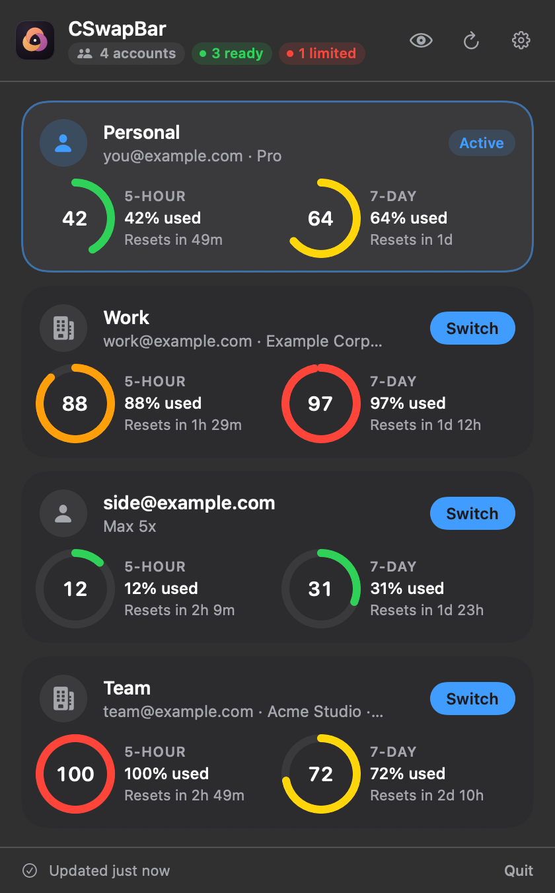
  &nbsp;&nbsp;
  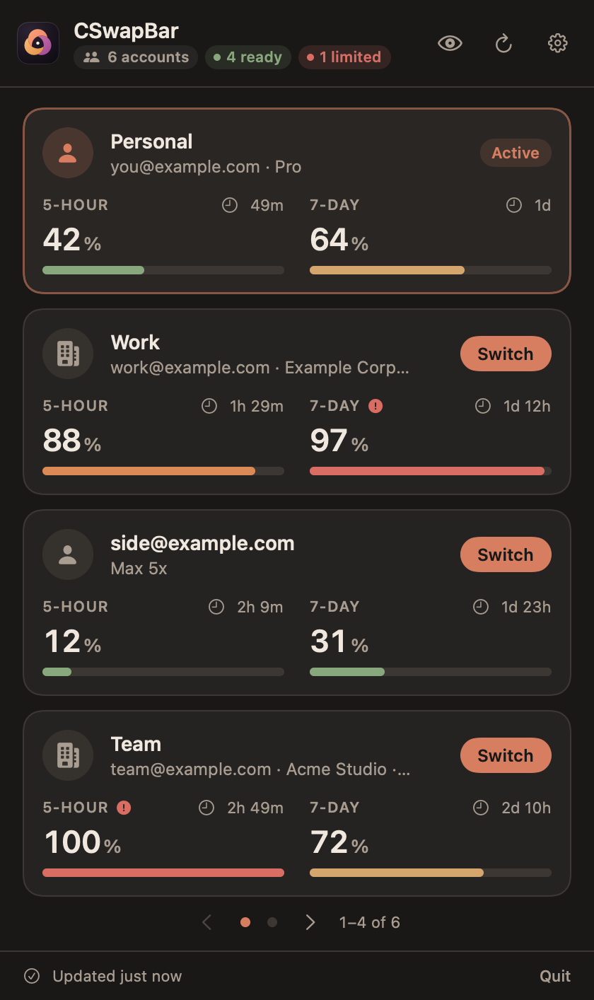
</p>

> **Unofficial.** CSwapBar is a community project built on top of CSwap. It is not affiliated with or endorsed by the CSwap project or Anthropic.

---

## Features

- **Every account at a glance.** 5-hour and 7-day usage, reset countdowns, plan, and organization for each account CSwap manages.
- **One-click switching.** CSwapBar reports success only after CSwap confirms the switch.
- **Privacy Mode.** One toggle (⇧⌘P) hides emails, names, organizations, and plans everywhere: cards, the menu-bar title, notifications, and screen-reader labels. Accounts become "Account 01", "Account 02", and so on.
- **Desktop widgets.** Three compact widgets (Gauge, Active Account, All Accounts) that sit on your desktop or float on top. Drag them anywhere; they follow your theme and Privacy Mode.
- **Four layouts.** Meters, Classic, Rings, or a dense List. Pages of 4 by default, and the popover's height always fits its content.
- **23 themes.** Including **macOS Widgets** (Apple system colors, like the Calendar and Battery widgets), **macOS** (system materials and your accent color), vivid gradients, and high-contrast options. Every theme passes WCAG contrast checks in the test suite.
- **Mac-native typography.** SF Pro, SF Pro Rounded, New York, or SF Mono, in three text sizes.
- **Local-first and private.** No backend, no telemetry, no stored credentials. CSwap stays the source of truth.
- **Tiny.** About 20 MB of memory and near-zero idle CPU.

## Screenshots

<table>
  <tr>
    <td align="center">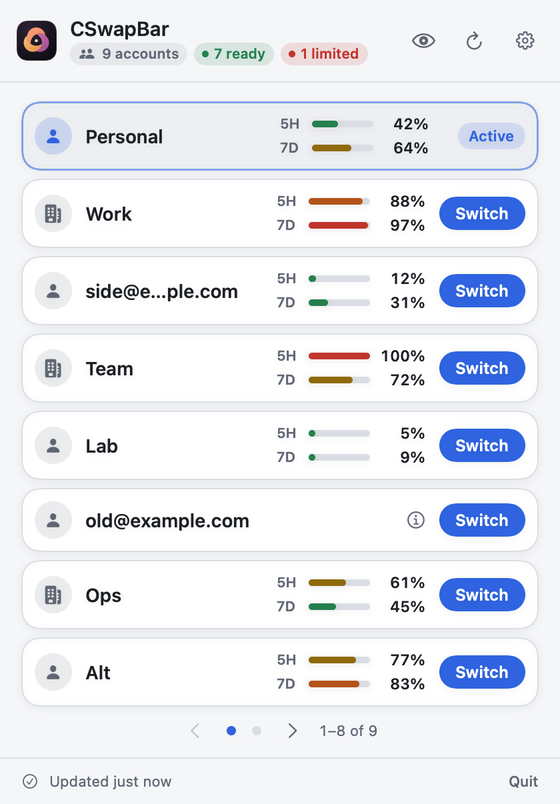<br><sub><b>List</b> · Paper</sub></td>
    <td align="center">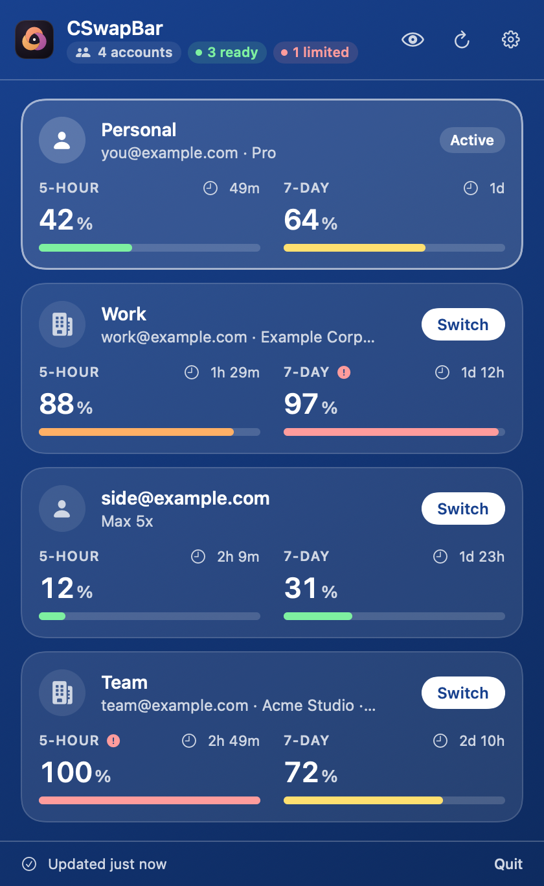<br><sub><b>Meters</b> · Sky</sub></td>
    <td align="center">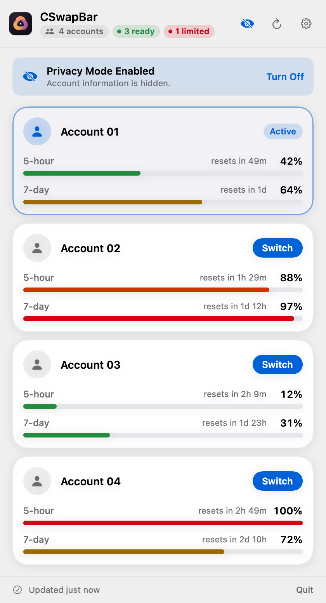<br><sub><b>Privacy Mode</b> · macOS Widgets</sub></td>
  </tr>
</table>

<p align="center">
  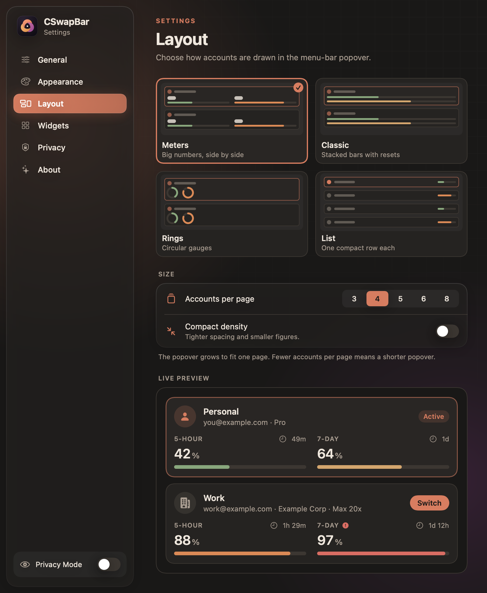
</p>

<details>
<summary><b>More: Appearance, Widgets, and Privacy settings</b></summary>
<br>
<p align="center">
  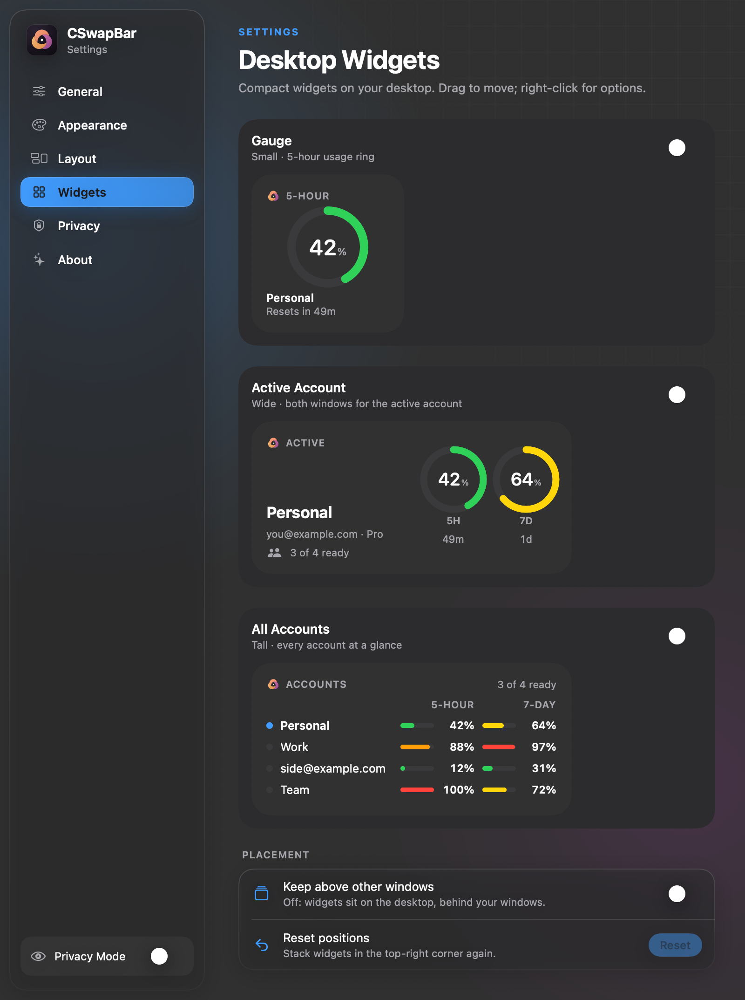
</p>
<p align="center">
  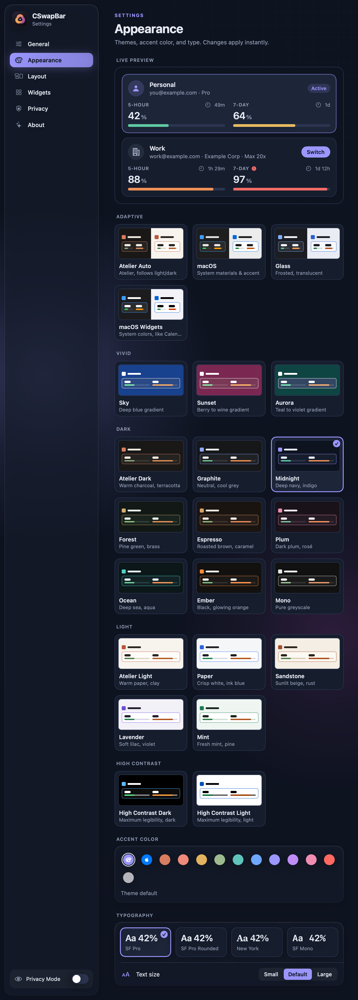
</p>
<p align="center">
  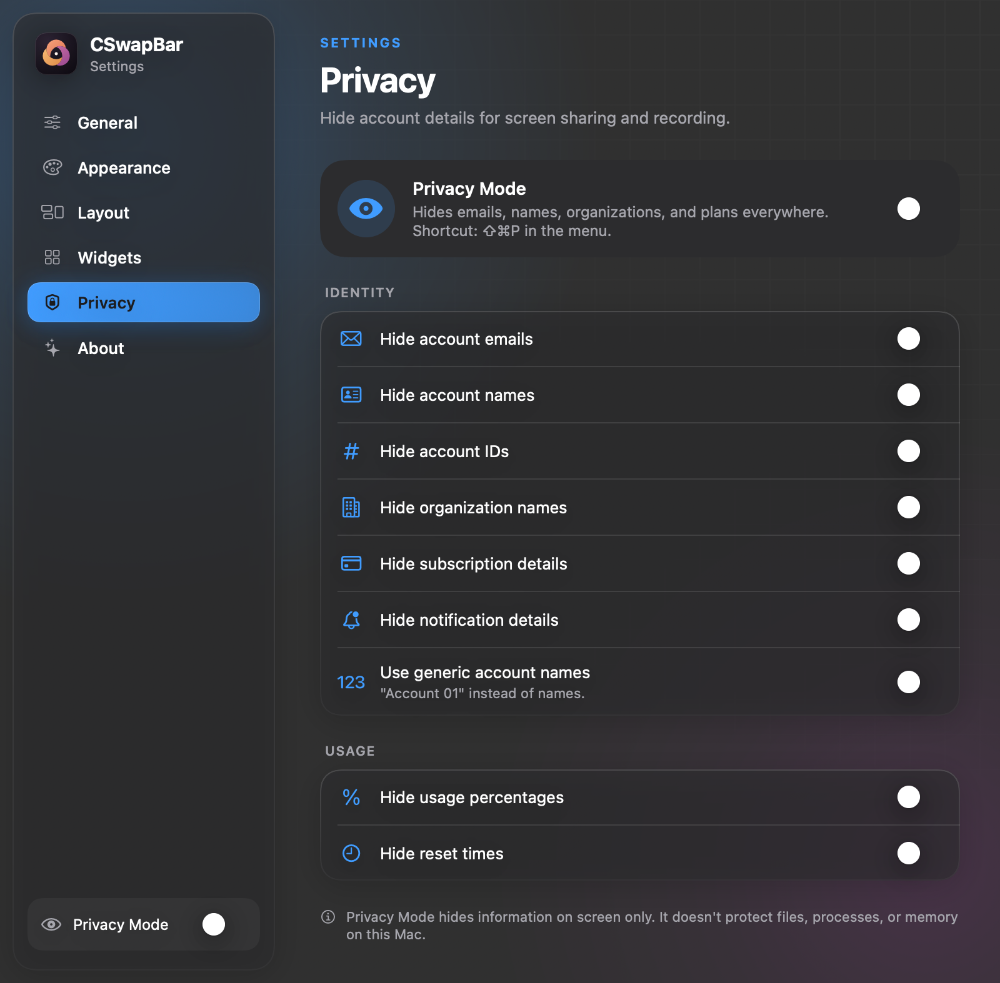
</p>
</details>

<sub>All screenshots use made-up sample accounts.</sub>

## Desktop widgets

Turn them on in **Settings → Widgets**. Right-click a widget to hide it or open Settings.

<p align="center">
  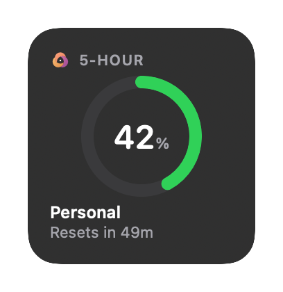
  &nbsp;
  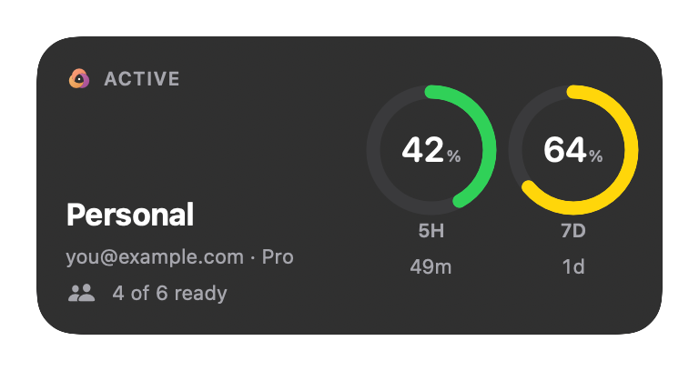
  &nbsp;
  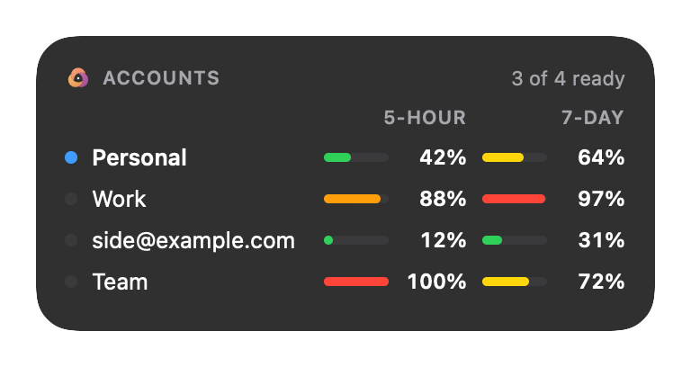
</p>

These are built into the app, not WidgetKit, so they need no Xcode extension or Apple Developer account.

## Requirements

- macOS 14 Sonoma or later
- [CSwap](https://github.com/realiti4/claude-swap) 1.1.0 or later, with your accounts added:

  ```bash
  uv tool install claude-swap
  cswap add          # once per Claude account
  ```

## Install

### Download the DMG (recommended)

1. Download **CSwapBar-&lt;version&gt;.dmg** from the [latest release](https://github.com/iamv1n/CSwapBar/releases/latest).
2. Open it and drag **CSwapBar** onto **Applications**.
3. Allow the first launch. CSwapBar is open source but **not notarized** by Apple, so macOS blocks it once:
   - **macOS 15 Sequoia or later:** try to open it and click **Done**. Then go to **System Settings → Privacy & Security** and click **Open Anyway**.
   - **macOS 14 Sonoma:** right-click the app in Applications, choose **Open**, then click **Open**.
   - **Any version:** `xattr -dr com.apple.quarantine /Applications/CSwapBar.app`

The [install guide](docs/INSTALL.md) has step-by-step details, a fix for the "damaged" message, checksum verification, updating, and uninstalling.

### One-line install from source

Builds locally, so there's no Gatekeeper prompt. Needs the Command Line Tools (`xcode-select --install`):

```bash
curl -fsSL https://raw.githubusercontent.com/iamv1n/CSwapBar/main/scripts/get.sh | bash
```

### Build from source

```bash
git clone https://github.com/iamv1n/CSwapBar.git
cd CSwapBar
./scripts/install.sh
```

## Using CSwapBar

| Action | How |
| --- | --- |
| Open the popover | Click the ⇄ icon in the menu bar |
| Switch account | Click **Switch** on any card |
| Privacy Mode | Eye icon, or **⇧⌘P** while the popover is open |
| Refresh now | **⌘R** |
| Next / previous page | **→ / ←** |
| Settings | Gear icon, or **⌘,** |
| Quit | **⌘Q** |

## How it works

CSwapBar holds no credentials and has no backend. It runs the `cswap` CLI directly, without a shell and with timeouts (`list --json`, `status --json`, `switch <n> --json`), and shows the results. After every switch it asks CSwap for the active account and reports success only once CSwap confirms it.

CSwap also ships its own menu bar (`cswap menubar`). CSwapBar is an alternative front end focused on a native interface, Privacy Mode, and customization. If you run both, both will poll usage.

Privacy Mode hides information on screen. It doesn't protect files, processes, or memory on your Mac.

Using multiple Claude accounts is your responsibility under Anthropic's terms.

## Development

```bash
git clone https://github.com/iamv1n/CSwapBar.git && cd CSwapBar
./scripts/setup.sh --run     # checks tools, builds, tests, launches a debug build
```

[DEVELOPMENT.md](DEVELOPMENT.md) covers the architecture, scripts, debug and snapshot flags, testing, and the release process. [CONTRIBUTING.md](CONTRIBUTING.md) covers the ground rules and PR workflow. See [ROADMAP.md](ROADMAP.md) for what's next and [CHANGELOG.md](CHANGELOG.md) for what's shipped. CSwapBar uses [Semantic Versioning](https://semver.org); the current version is in [`VERSION`](VERSION).

## About the author

<table>
  <tr>
    <td>
      <a href="https://github.com/iamv1n"></a>
    </td>
    <td>
      <b>Vineet Anil Likhitkar</b><br>
      Designed and built CSwapBar.<br>
      Find more of my work on GitHub: <a href="https://github.com/iamv1n">@iamv1n</a>
    </td>
  </tr>
</table>

## Credits

Built on [CSwap (claude-swap)](https://github.com/realiti4/claude-swap) by Onur Cetinkol, MIT License. See [NOTICE](NOTICE).

"Claude" and "Claude Code" are trademarks of Anthropic, used here only to describe compatibility.

## License

MIT © 2026 Vineet Anil Likhitkar. See [LICENSE](LICENSE).
